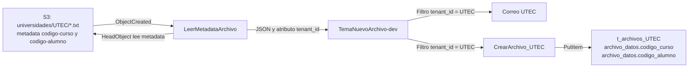

# Semana 13, Taller 2: metadata de archivos

Este proyecto implementa el ejercicio propuesto del curso **CS2032 Cloud Computing** con Serverless Framework **v3.40.0**. Cuando se sube un `.txt` a `universidades/<tenant>/`, S3 invoca `LeerMetadataArchivo`. Esta función consulta `HeadObject` para obtener los metadatos personalizados `codigo-curso` y `codigo-alumno`, además de tamaño y fecha de modificación. Publica el resultado en SNS con el atributo `tenant_id`. SNS entrega solo los mensajes de `UTEC` a `CrearArchivo_UTEC` y a la suscripción de correo. La segunda función guarda el registro en `t_archivos_UTEC`.

La tabla usa `tenant_id` como clave de partición y `archivo_id` como clave de ordenación. Los códigos quedan en `archivo_datos.codigo_curso` y `archivo_datos.codigo_alumno`, siguiendo la estructura `archivo_datos` de la clase. Los valores de prueba son **CS2032** y **202410083**. No están fijos en el código: se leen de cada objeto S3. Las Lambdas usan el rol existente `arn:aws:iam::904208419583:role/LabRole`, porque el laboratorio no permite crear un rol IAM nuevo. Ese rol debe permitir `s3:GetObject`, `sns:Publish`, `dynamodb:PutItem` y escritura de logs en CloudWatch.

## Diseño de la solución



Para `UNIV2`, la primera Lambda publica el mensaje con `tenant_id = UNIV2`; los filtros de SNS impiden que llegue a la segunda Lambda o al correo.

## Despliegue desde EC2

1. En AWS, usa una instancia EC2 en **us-east-1** con credenciales temporales válidas del laboratorio en la cuenta **904208419583**. La sesión puede aparecer como `assumed-role/voclabs/` o `assumed-role/LabRole/`. La ARN de `LabRole` por sí sola no entrega credenciales. Instala Git, AWS CLI, Node.js 20 o 22 y npm. No guardes claves AWS en el repositorio.
2. Comprueba los programas y la identidad:

   ```bash
   git --version
   aws --version
   node --version
   npm --version
   aws sts get-caller-identity
   ```

   El `Account` debe ser `904208419583`. El script de despliegue comprueba esta cuenta y también verifica que el bucket generado por Serverless incluya el mismo número de cuenta.

3. Descarga el proyecto y ejecuta la comprobación:

   ```bash
   git clone https://github.com/DiegoLadrondeGuevara/sem13-2cloud.git
   cd sem13-2cloud
   bash scripts/check-aws.sh
   ```

4. El despliegue usa las credenciales AWS temporales de la EC2. No requiere iniciar sesión en Serverless Dashboard: el nombre de organización proporcionado no se encontró allí (`Tenant not found`). Confirma que `aws sts get-caller-identity` sigue mostrando la cuenta **904208419583** antes de desplegar.
5. Despliega:

   ```bash
   bash scripts/deploy.sh
   ```

   La salida debe indicar el bucket `sem13-2cloud-dev-904208419583`, el tema `TemaNuevoArchivo-dev`, dos funciones Lambda y la tabla `t_archivos_UTEC`. También puedes consultar el estado con `npx serverless info --stage dev --region us-east-1`.
6. Abre el correo **ldeguevaradiego@gmail.com** y confirma la suscripción SNS. Hasta que se confirme, no llegarán mensajes al correo. La función que escribe en DynamoDB no depende de esa confirmación.

## Prueba y evidencias

Sube el archivo UTEC con los metadatos **en el momento de la carga**:

```bash
aws s3api put-object \
  --bucket sem13-2cloud-dev-904208419583 \
  --key universidades/UTEC/archivo01.txt \
  --body ejemplos/archivo01.txt \
  --metadata codigo-curso=CS2032,codigo-alumno=202410083 \
  --region us-east-1
```

Comprueba la metadata en S3:

```bash
aws s3api head-object \
  --bucket sem13-2cloud-dev-904208419583 \
  --key universidades/UTEC/archivo01.txt \
  --query '{Metadata:Metadata,ContentLength:ContentLength,LastModified:LastModified}' \
  --region us-east-1
```

Consulta el registro después de unos segundos:

```bash
aws dynamodb get-item \
  --table-name t_archivos_UTEC \
  --key '{"tenant_id":{"S":"UTEC"},"archivo_id":{"S":"universidades/UTEC/archivo01.txt"}}' \
  --region us-east-1
```

El resultado debe mostrar `archivo_datos.M.codigo_curso.S = CS2032` y `archivo_datos.M.codigo_alumno.S = 202410083`.

Prueba el filtro con otro tenant:

```bash
aws s3api put-object \
  --bucket sem13-2cloud-dev-904208419583 \
  --key universidades/UNIV2/archivo01.txt \
  --body ejemplos/archivo01.txt \
  --metadata codigo-curso=CS2032,codigo-alumno=202410083 \
  --region us-east-1
```

Debe aparecer un mensaje publicado por `LeerMetadataArchivo`, pero ningún registro `UNIV2` en `t_archivos_UTEC` ni correo para ese archivo. Compruébalo con:

```bash
aws dynamodb get-item \
  --table-name t_archivos_UTEC \
  --key '{"tenant_id":{"S":"UNIV2"},"archivo_id":{"S":"universidades/UNIV2/archivo01.txt"}}' \
  --region us-east-1
```

La respuesta correcta no incluye `Item`.

Para el documento de evidencias, toma capturas de: (1) `aws sts get-caller-identity` y `npx serverless --version`; (2) salida de `serverless deploy` y recursos de CloudFormation; (3) bucket y metadata del objeto UTEC en S3; (4) tema SNS y las dos suscripciones con filtro `tenant_id = UTEC`; (5) logs de ambas funciones en CloudWatch; (6) registro DynamoDB con los dos códigos; (7) objeto UNIV2 y ausencia de registro/correo. Oculta cualquier dato de acceso que aparezca en pantalla.

## Notas

- La notificación S3 solo procesa rutas bajo `universidades/` terminadas en `.txt`.
- S3 no incluye los metadatos personalizados en el evento. Por eso `LeerMetadataArchivo` llama a `HeadObject` antes de publicar en SNS.
- Si faltan uno o ambos códigos, la función registra un error y no publica el archivo. Revisa CloudWatch y vuelve a cargarlo con ambos metadatos.
- El nombre del bucket incluye la etapa y la cuenta para evitar colisiones globales. La tabla conserva el nombre exacto solicitado por el ejercicio.
- Para destruir la infraestructura cuando ya no se necesite: primero vacía el bucket de pruebas y luego ejecuta `npx serverless remove --stage dev --region us-east-1` desde la misma cuenta y rol. Conserva las capturas antes de hacerlo.
